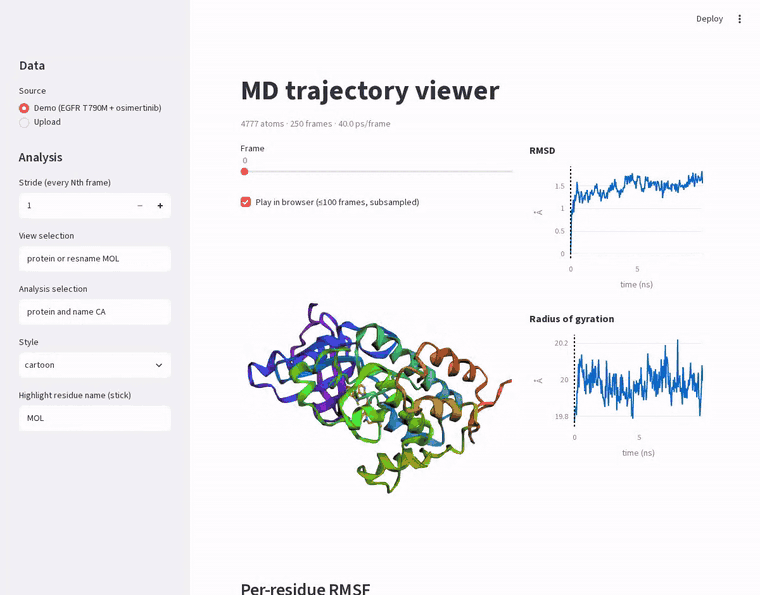

# MD trajectory viewer

**Live demo:** https://md-trajectory-viewer.streamlit.app/

**Question.** A browser tool to load, play and analyse molecular dynamics trajectories.



## Data
Topology + trajectory files (PDB/GRO + XTC/DCD); demo data from the egfr-mmgbsa runs.

## Approach
1. Streamlit + MDAnalysis + 3Dmol.js (loaded from a CDN in the browser) + Plotly
2. Frame slider with 3D view; live RMSD and radius of gyration (Plotly)
3. Per-residue RMSF and MDAnalysis selection syntax
4. Striding/subsampling and upload limits for large files; pytest for analysis functions

## Deliverables
Deployed app with a demo trajectory and a GIF in this README.

## Run
```bash
python -m venv .venv && . .venv/bin/activate
pip install -r requirements.txt
streamlit run app.py          # demo trajectory loads by default
pytest                        # analysis functions
```
Upload limit is 200 MB per file (`.streamlit/config.toml`). Use the stride control for long trajectories.

## Demo data
`demo/egfr_T790M_osimertinib.{pdb,xtc}`: EGFR T790M kinase domain with osimertinib, protein + ligand only,
250 frames over 10 ns, cut from a 10 ns explicit-solvent run of the egfr-mmgbsa project with
`scripts/make_demo.py` (unwrapped, centred on the protein, solvent and ions removed).

## Limitations
- **Verified on the demo only.** The live app was checked with the bundled demo trajectory (loading, playback, RMSD and radius of gyration). File upload, large trajectories and the stride control are implemented but **not verified on the deployed app**. The per-residue RMSF plot works locally with the demo (289 residues, 250 frames) but was **not verified on the deployed app**.
- **One demo system.** The demo is EGFR T790M + osimertinib only; no wild-type or other mutant systems are included.
- **Memory and size.** Uploads are capped at 200 MB per file (`.streamlit/config.toml`), and Streamlit Community Cloud has its own, smaller memory budget that this app has not been tested against. Uploaded trajectories are written to a temporary directory and are not deleted until the server restarts. RMSF loads the strided trajectory into memory, so very long trajectories need a larger stride.
- **Browser playback is capped.** In-browser play is subsampled to at most 100 frames, and the whole multi-model PDB is embedded in the page (about 32 MB for the full demo system, 4777 atoms). Use a narrower view selection for large systems. 3Dmol.js is loaded from a CDN, so playback needs internet access.
- **Simple analysis.** RMSD is measured against frame 0 after least-squares fitting on the analysis selection, with no mass weighting, and RMSF fits on the same selection. Trajectories are not unwrapped or centred by the app; the demo was prepared with `scripts/make_demo.py`.
- **Default selections assume the demo.** The default view selection (`protein or resname MOL`) and highlight residue name (`MOL`) fit the demo ligand; change them for other systems.
- **Shared loaded trajectory.** Loaded trajectories are cached per file path and shared across browser sessions in one server process; simultaneous sessions on the same file were not tested.
- **Idle sleep.** On Community Cloud the app sleeps when idle and needs a wake-up click.

## Status
App works locally with the demo trajectory: frame slider and in-browser playback, RMSD, radius of gyration,
per-residue RMSF, MDAnalysis selection syntax, upload with size limit. Deployed on Streamlit Community Cloud (the app sleeps when idle; wake it with the button).
Part of a 30-project computational biology and scientific software portfolio.
